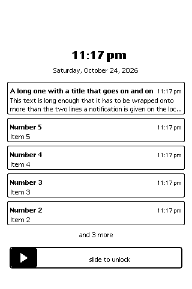

# The lock screen: auto-lock and notifications

A host addition (the ROM has no lock screen): a screen that covers
everything with the time, the date, the notifications applications have
left on it, and a slider dragged across to unlock.  It began as the T-Deck
Pro's (locked from its quick sheet, a finger pulled down from the top
edge); since 2026-10-25 it is installed on every host, it locks by itself
when the machine has been left alone for a time chosen on the Host
preferences page, and **any application can ask whether the screen is
locked and leave a notification on it** - the interface below.  Messages
and Mesh use it.

Sources: `src/host/HostQuickSheet.ns` (the lock screen, the notifications,
the auto-lock's watch, the global functions), `src/host/HostQuickSheet.cpp`
/ `.h` (the natives, `HostQuickSheetSetAutoLock`), the Host page's
`autoLock` (`src/host/HostSettings.cpp`), the activity count
(`HostNoteUserActivity`, `src/hal/host/HostPower.h`).  Ctest
`host.NewtonLockScreen` (`src/host/demo/lockscreen.ns`); the
applications' use in `host.NewtonMessages.*` and `host.NewtonMesh.*`.

## What the user sees



- **Locking.** By hand from the T-Deck Pro's quick sheet ("Lock screen"),
  from a script or an application (`ScreenLockNow()`), or by the
  **auto-lock**: Extras, Prefs, Host, **Auto-lock** - Never (the default),
  or after 1, 2, 5, 10 or 30 minutes in which nobody has touched the pen or
  the keys.  The choice is kept in the System soup with the Host page's
  other settings and put back at boot.
- **Unlocking.** The knob dragged from the slider's left end to its right.
  A press that does not start on the knob does nothing and a knob let go
  short of the end goes back, so a tap anywhere cannot unlock it.
- **Notifications.** Between the date and the slider, newest first, each a
  frame with its title in bold, the time it came at the right (the date if
  not today) and its text below in at most two lines (cut short with
  "..."); as many as fit the screen, then "and N more".  A tap on one
  **chooses** it (its frame drawn thick, "Unlock to open" where the time
  was); a tap on it again leaves it.  At the unlock every notification is
  taken off the lock screen and handed back to its application: the
  chosen one is *opened* (the application shows what it is about), the
  rest are *unlocked* (the application shows what it would have shown had
  the screen not been locked - Messages and Mesh their alert slip).

## The interface

Global functions, defined at boot by the lock screen's `Start` on every
host.  A package that may also run on a real MessagePad (or an older
build) checks for them first: `GetGlobalFn('ScreenLockIsLocked)`.  (The
ROM's own `LockScreen` and `ReleaseScreenLock` are something else -
QuickDraw's screen-update locks - hence the `ScreenLock` prefix.)

| function | returns | what it does |
|---|---|---|
| `ScreenLockIsLocked()` | `true` or `nil` | whether the lock screen is up |
| `ScreenLockNow()` | `true` | locks the screen now (already locked: nothing) |
| `ScreenLockNotify(appSymbol, notification)` | `true`, or `nil` | leaves a notification on the lock screen - `nil`, and nothing kept, when the screen is not locked or the arguments will not do |
| `ScreenLockWithdraw(appSymbol, key)` | how many were taken off | takes the application's notification with that key off the lock screen; `key` `nil`: all of the application's |
| `ScreenLockNotifications()` | an array, newest first | what the lock screen holds: frames `{appSymbol, key, title, text, time, chosen}` (copies: changing them changes nothing) |
| `RegScreenLockChange(callbackID, fn)` | `true` | `fn` called with `true` after the screen locks and `nil` after it unlocks (after the notifications have been handed back); one per `callbackID` (a symbol), a second replacing the first |
| `UnRegScreenLockChange(callbackID)` | `true` | ... no longer |

### The notification frame

```
{key:      'unread,                      // optional: one notification per application and key
 title:    "Text from Ada",              // a string, shown in bold on one line
 text:     "See you at eight",           // a string, wrapped to two lines at most
 time:     Time(),                       // optional: minutes, as Time() gives; now if left out
 Opened:   func() ...,                   // optional: chosen on the lock screen, at the unlock
 Unlocked: func() ...}                   // optional: not chosen, at the unlock
```

- `key` is compared as `=` compares (strings by their characters).
  Notifying again with the same `appSymbol` and `key` **replaces** the
  notification - its words, its time and its place at the top (whether it
  was chosen is kept) - which is how a count of unread messages stays one
  notification.  Different keys make separate notifications.
- `Opened` and `Unlocked` are sent to the frame itself (`note:?Opened()`),
  each inside its own exception handler, so a notification that throws
  does not stop the others being handed back.  Only one of them is ever
  sent, once, and only if the notification is still on the lock screen at
  the unlock (withdrawn: neither).  The chosen notification's `Opened` is
  sent last, so that what it opens is on top.
- The lock screen keeps at most 20 notifications; past that the oldest is
  dropped (without `Unlocked`).
- Nothing is queued while the screen is not locked: `ScreenLockNotify`
  answers `nil` and the application tells the user its usual way.

### How an application uses it

The pattern Messages and Mesh follow (`src/comms/host/HostMessages.ns`,
`HostMesh.ns`, "The lock screen"):

```
// news for the user
if GetGlobalFn('ScreenLockIsLocked) and ScreenLockIsLocked()
   and ScreenLockNotify(kAppSymbol, {key: 'news, title: title, text: body,
        Opened:   func() GetGlobalVar('|MyApp:me|):OpenAtNews(),
        Unlocked: func() GetGlobalVar('|MyApp:me|):ShowNewsSlip()}) then
    nil                                   // on the lock screen
else
    :ShowNewsSlip();                      // as before
PlaySound(...);                           // a beep either way

// the news seen some other way (the application opened): taken off
if GetGlobalFn('ScreenLockWithdraw) then
    call GetGlobalFn('ScreenLockWithdraw) with (kAppSymbol, 'news);
```

- Don't treat what came while the screen was locked as seen, even if the
  view that shows it is open behind the lock screen: the user cannot see
  it.  (Messages and Mesh leave such a message unread, and mark it read at
  the unlock when its conversation is the one open.)
- The `Opened`/`Unlocked` closures should find the application through its
  global (as above), not hold on to views that may have closed meanwhile.
- `RegScreenLockChange` is for an application that wants to do something
  itself as the screen locks or unlocks (stop a display that nobody can
  see, refresh one when it can be seen again); notifications do not need
  it.

### Messages and Mesh

While the screen is locked, a text (Messages) or a mesh message (Mesh)
that would have opened or updated the application's alert slip leaves one
notification on the lock screen instead (key `'unread`), updated as the
slip is: the first message's sender and text, then "Messages: 2 unread" /
"Mesh: 2 unread messages" and the latest.  This happens whether or not the
application is open (open, it would otherwise only beep).  At the unlock:

- **chosen** on the lock screen: the application opens at the conversation
  (or the list, when the messages came from more than one) - the slip's
  Show;
- **not chosen**, the application closed: its alert slip comes up saying
  what the notification said;
- **not chosen**, the application open: the conversation open takes in
  what came (read now, if it is the one they came to); no slip.

Opening the application some other way withdraws the notification.

## The auto-lock

The host counts the user's activity - each pen sample from the window or
the board's panel and each key (`HostNoteUserActivity`, called by
`HostTabletRawPenDown`/`Move` (the window's pen), `HostTabletPenDown`/`Move`
and the queued ones (a script's), the raw tap, and `HostKeyboardPush`) -
and the lock screen's `Watch` looks at the count (`HostUserActivity()`)
every few seconds (a quarter of the time set, between one and five
seconds; every 30 seconds while the auto-lock is off).  The time left
alone is counted again from any change of the count, from a change of the
setting (`HostSetAutoLock` restarts the watch at once), and from the
unlock; once it reaches the time set, `Lock` is sent.

| native | |
|---|---|
| `HostUserActivity()` | the count (an integer that wraps: only a change of it means anything) |
| `HostAutoLockSeconds()` | the time set, in seconds (0: never) |
| `HostSetAutoLock(seconds)` | sets it - the Host page's choice does, in minutes; a test sets a few seconds |

On the T-Deck Pro the lock screen also tells the board
(`HostScreenLocked` → `HostDeviceSetLocked`): the keyboard's presses are
left out and its light is off while it is locked.

## Not yet

- The machine's sleep does not lock the screen: a MessagePad woken by its
  power switch comes back as it was.  A phone-like host may want the
  screen locked as it goes to sleep.
- The lock screen keeps its layout if the screen is turned while it is up.
- No passcode: the slider is the only way through.
